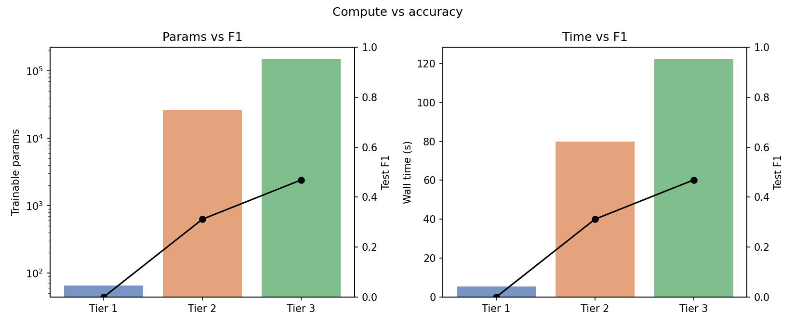
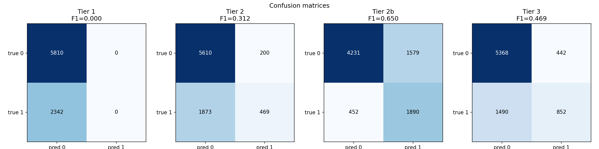

# Protest Image Classification Under Compute Constraints

Does a bigger model detect protest images better? This project trains four classifiers on the UCLA Protest Image Dataset and reports parameter count and training time next to F1, so the cost of each gain is visible.

Seminar paper for *Multimodal Computational Methods* (Power in Pixels), LMU München, 2026.

## Findings

- **Training strategy mattered more than architecture.** Adding data augmentation to a 26k-parameter CNN raised test F1 from 0.31 to 0.65, the largest effect in the experiment.
- **The bigger model lost.** A Vision Transformer with nearly six times as many parameters trained longer and reached F1 0.47.
- **Accuracy is misleading on imbalanced data.** The frozen baseline scores 71% accuracy while never predicting a single protest (F1 0.00), because 71% of test images show no protest.

## Results

Test set: 8,152 images, 28.7% protest. Decision threshold 0.5 for all models.

| Tier | Model | Trainable params | Train time (s) | F1 | Precision | Recall | Accuracy |
|---|---|---:|---:|---:|---:|---:|---:|
| 1 | Frozen random CNN + logistic regression | 65 | 4.3 | 0.000 | 0.000 | 0.000 | 0.713 |
| 2 | CNN, no augmentation | 25,921 | 71.4 | 0.312 | 0.701 | 0.200 | 0.746 |
| 2b | CNN + augmentation | 25,921 | 99.0 | **0.650** | 0.545 | 0.807 | 0.751 |
| 3 | Vision Transformer, from scratch | 152,001 | 128.6 | 0.469 | 0.658 | 0.364 | 0.763 |

Validation F1 moves the same way (0.297 without augmentation, 0.642 with), so the augmentation effect is not an artefact of one evaluation split.





The error profiles differ as much as the scores: the plain CNN misses 80% of protest images, the augmented CNN misses 19% but flags 27% of non-protest images. Which one is "better" depends on whether a downstream researcher can afford missed events or false alarms.

## Setup

- **Data:** full corpus, stratified into 29,349 train / 3,261 validation / 8,152 test images, resized to 96×96.
- **Training:** Adam (lr 1e-3), 8 epochs, batch size 32, identical split for every model.
- **Tier 1:** three convolutional layers left at random initialisation produce a 64-d embedding; only a logistic regression on top is fitted.
- **Tier 2 / 2b:** three strided convolutional blocks with batch normalisation, global average pooling, dropout and a 32-unit dense layer, trained end to end. 2b adds random flip, rotation and contrast during training only.
- **Tier 3:** ViT with 16×16 patches, learned positional embeddings, three pre-norm transformer blocks with 4-head attention.

## Limitations

- The ViT was trained without augmentation, so the 2b vs. 3 comparison mixes architecture and training strategy. Augmenting both would isolate the architecture effect.
- All models use a fixed 0.5 threshold and no ranking metric (ROC-AUC, PR-AUC). Part of the augmentation gain may be a shift in predicted probabilities relative to the threshold rather than better separation of the classes.
- One seed per model; no variance estimate.
- Tier 1 uses random, untrained features. A pretrained backbone would be a much stronger cheap baseline.
- 96×96 input discards detail compared to the 224×224 used in the original benchmark.

## Code

Everything runs from `pipeline.ipynb`. Some choices that keep runs comparable and reproducible:

- All parameters live in one `Config` dataclass, so a variant is a one-line change.
- The data split seed and the model seed are separate, so changing model initialisation never changes which images land in which split.
- Preprocessed arrays are cached to disk, and the cache is keyed on every config field that affects it. Changing image size or split sizes rebuilds the cache instead of silently reusing stale data.
- Input validation fails early with a specific message if the dataset layout is wrong or an annotated image is missing.
- Tiers 2 and 3 share one training and evaluation function, so metrics are computed identically for every model.

## Reproduce

The dataset is not included. Get the UCLA Protest Image Dataset and place it next to the notebook:

```
annot_train.txt
annot_test.txt
img/train/*.jpg
img/test/*.jpg
```

Then:

```
pip install -r requirements.txt
```

and run `pipeline.ipynb` top to bottom. Results go to `results_cache/`, figures to `figures/`.

## Reference

Won, D., Steinert-Threlkeld, Z. C., & Joo, J. (2017). Protest activity detection and perceived violence estimation from social media images. *Proceedings of the 25th ACM International Conference on Multimedia*, 786–794.

## Author

Bruno Zaro Steffen, M.Sc. Computational Social Science, LMU München
